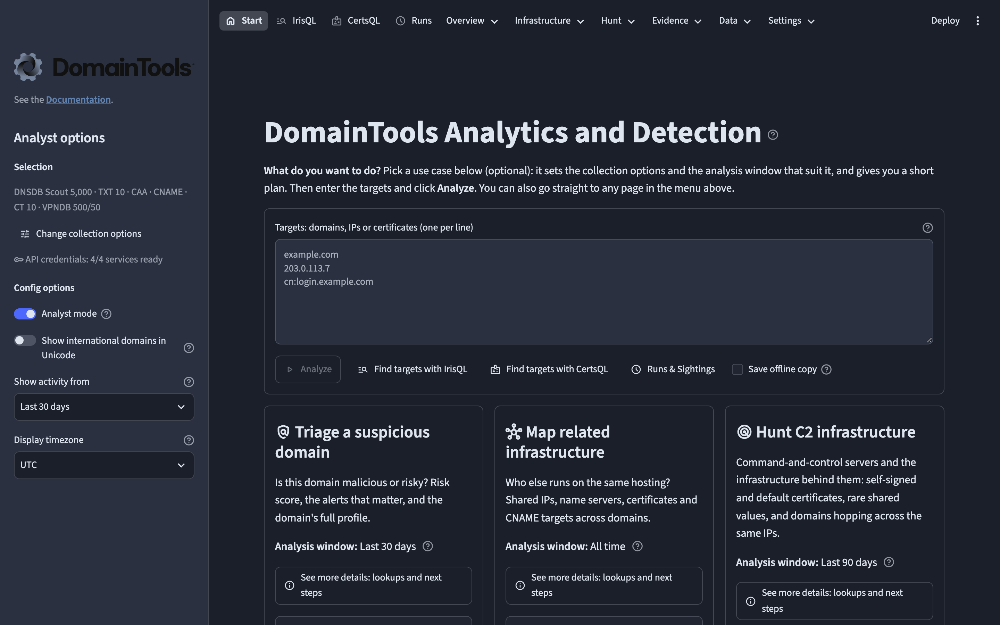

# DomainTools Analytics and Detection

An unofficial Streamlit tool that combines several DomainTools data sources (Iris Investigate with its risk scores,
Domain History, passive DNS from DNSDB Scout, and the Certificate API with search, hostname / IP /
SHA-256 events and CT logs) with VPNDB's VPN, residential proxy and Tor attribution of IPs and, where the internal
BGPDB service is reachable, the BGP routing of the hosting IPs, and runs a behavioral threat engine over the combined
telemetry.

> **Disclaimer:** this is not an official DomainTools application. It is an example of a custom-built application
> that shows how the DomainTools Python SDK and the other DomainTools APIs can be used to get DomainTools data and
> use it for analysis and basic detection. It is provided as an example, without support; its alerts, scores and
> verdicts are heuristics, so check the evidence before acting on them. Lookups use your own API keys and quotas.
> The app shows this disclaimer on its first start, before it asks for API credentials.



*The Start page: enter domains, IPs or certificates in the Targets box and click **Analyze**, or first pick a use
case (it sets the lookups, limits and analysis window). Next to Analyze: find targets with IrisQL or CertsQL, open
Runs & Sightings, tick *Save offline copy*, or *Clear* the box. The sidebar holds the Analyst options.*

## Documentation

| Guide | Covers |
| --- | --- |
| [Workflows](docs/WORKFLOWS.md) | **Start here if you are new:** what happens after *Analyze*, the order and logic of every data collection (with diagrams), and what each source is used for |
| [Use Cases](docs/USE_CASES.md) | The investigations the tool supports: what to enter, where to look in the results, and what each one surfaces |
| [Installation](docs/INSTALLATION.md) | Requirements, install, **credentials** (entering keys in the app, environment, `credentials.toml`, files, the API Credentials panel), starting the app, development |
| [Usage](docs/USAGE.md) | Running an analysis, every option, offline datasets, where local data is stored, troubleshooting |
| [Reference](docs/REFERENCE.md) | Everything preconfigured: what each **use case** looks up, the **brand watchlist**, every **collection limit**, the **built-in lists** (hosting watchlist, impersonated brands, takeover-prone services, ...) and the files the app keeps |
| [User Guide](docs/USER_GUIDE.md) | Reading the results: alerts and grouping, **severity / confidence / category**, the full **detection catalogue**, **MITRE ATT&CK mapping**, **Unified Risk** vectors, **DIF fingerprints**, clusters and domain hopping, thresholds, run history, suppressions and exports |

## What it does

- **Collects** domain, DNS, certificate and enrichment data per target, with per-source status so errors and
  truncated results are never silent. Targets can be domains, IPs, or certificates (fingerprints, CN, SAN,
  public key, serial, organization, issuer), which are resolved to the domains and IPs they cover. Where passive DNS
  stops at its limit, TXT, CAA and CNAME lookups fill in what the detections need.
- **Detects** 106 behaviors (fast-flux, parked-to-weaponized, CAA breaches, abnormal certificate rotation, DNS tunneling,
  dangling CNAMEs, NS, MX and SPF records, shared infrastructure, domain hopping, lookalikes, re-registered domains, phishing kit staging,
  campaign waves, ...), each with a severity, a confidence, a category and a MITRE ATT&CK technique. Your verdicts on
  a rule's alerts tune its confidence, and an infrastructure allowlist keeps your own infrastructure out.
- **Chases CNAME chains** like DNSDB Scout: every alias followed to its final addresses, with the target service
  (dynamic DNS / tunnel, takeover-prone, free hosting, CDN), dead ends that point to subdomain takeover, and the
  names and addresses that link the analyzed domains through their chains; reverse CNAME (RDATA) lookups find
  other domains pointing to the same targets.
- **Resolves the DNS tree** like the Super Resolver (*DNS resolution*): every current A, AAAA, CNAME, MX, NS and SPF
  record followed to IP addresses, from passive DNS and on-demand DNSDB lookups (the current tree of busy domains is
  discovered with time-fenced lookups). **Dangling DNS** lists the records whose target doesn't exist and can be
  claimed (Critical when its domain may be unregistered or it is on a takeover-prone service); stale records
  (certificate validation leftovers, missing own names) are listed apart. Internal IPs and bogons are flagged, and
  BGPDB adds each resolved address's origin, RPKI / IRR and visibility (BGP page → *Resolved addresses*).
- **Profiles certificates** (*Certificate profile*): one certificate field by field in one anatomy view (trust flow,
  field fingerprint, validity timeline, key strength, a card per X.509 section with the flags under their fields and
  OIDs named), its shape and how it compares with its issuer's other certificates, related certificates (same key,
  notable JA4X, SAN set, the same or a near shape) and where it was seen. The Certificates page's *Families &
  anomalies* groups certificates made the same way (issuer, key, validity band, extension layout, policy, serial
  length, SAN profile) and lists what each does differently from its issuer, from normal CT logging, and bulk or
  tool-made patterns; *Field breakdown* shows how often each field is filled across the run and its rare values.
- **Compares domains** (*Domain similarity*): how alike the domains are built, from Iris, passive DNS, certificates,
  VPNDB and BGPDB, with similar pairs, clusters and the indicators each cluster shares.
- **Attributes anonymizers** with VPNDB: which hosting IPs are VPN, residential proxy or Tor exits and whose, whether
  an exit is shared (it identifies the service, not the actor) or dedicated, whether the IP was an exit while the
  domain used it, the ranges and networks around the hosting, and other domains on dedicated exits. Every use case
  checks VPNDB within its own query budget; *Check IP addresses* looks up IPs and CIDR ranges in VPNDB only, with
  every address of a range checked.
- **Reads the BGP routing** of the hosting IPs with BGPDB (an internal DomainTools service; optional): the announced
  prefix and the network that announces it, whether RPKI / IRR authorize it, the RIR allocation, the AS paths and
  upstreams, the networks' age and visibility, and the prefixes announced around them. Alerts on origin conflicts
  (possible hijacks), unauthorized origins, newly announced prefixes, young networks and thin routes, and on VPNDB
  exits that sit on such routing. A BGP page (Sankey, AS-path graph, origin timeline, networks, neighbours, VPNDB
  match), a BGP block on the Summary and a BGP line on each Hunt map box.
- **Finds targets with IrisQL**: an Iris Investigate query in IrisQL (`domain contains "domaintools"`) lists the
  matching domains with their risk, dates, registrar and hosting; tick domains and IPs, pick a use case and analyze
  them. The query editor suggests the fields, then only the operators each field accepts, then the value in the right
  form. Search works on the first click after typing, and Clear empties the query and its results. A watched query,
  checked again later, shows only the domains that are new.
- **Finds targets with CertsQL**: a Certificate Search query in CertsQL (`san_dns contains "login"`) lists the
  matching certificates with the domains, IPs and hostnames they name; the query is checked against the CertsQL field catalog before it is sent, with the same autocomplete as IrisQL. **Fields** adds any certificate field (the API's `select`) as a column to every results tab. Tick
  domains and IPs and analyze them.
- **Ranks pivots** (*Hunt map → All pivots*): every IP, name server, email, registrant, certificate and tracker in Iris Investigate, by how many
  domains share it, so rare links to the same operator come first; one click finds their other domains in Iris.
- **Triages subdomains** on shared platforms (pages.dev, workers.dev, free subdomain services) by phishing words,
  brands, embedded domains, generated names and bursts of new names.
- **Groups** alerts by finding, campaign cluster, domain or ATT&CK technique, with every related event in time
  order and pivotable artifacts (certificate hashes, IPs).
- **Scores** each domain with a Unified Risk score and a Domain Infrastructure Fingerprint (DIF) that exposes shared
  setups across domains.
- **Inventories hostnames** from certificates, passive DNS and certificate events, with lifecycle flags and each
  hostname's certificate hashes; a hostname focus narrows every view to chosen hostnames.
- **Tracks** runs over time: changes since the last run, first-detected alerts, trends, per-domain history,
  offline re-analysis without API calls; with *Monitor changes*, re-runs fetch only new passive DNS records. The
  *Runs* page shows the last runs as a timeline, one card per target list (what changed, risk trend, shared
  indicators) or a table (per list, or every run), runs one again or loads its offline copy, and compares runs and trends. The *Hunt map* (Hunt menu) draws each hunt with
  its open and done steps, and how runs connect: leads followed, and infrastructure different investigations share.
- **Finds earlier sightings** of an indicator (*Runs → Indicator Sightings*): every saved run and offline
  dataset where an IP, domain, name server, MX host, certificate hash, JA4X, tracker code or email was observed, with
  no API query. An indicator a run shares with other investigations opens its sightings in one click.
- **Watches API usage**: red and yellow banners on every page when a product the app uses has used up 95% or all of
  its monthly quota, or expires within 30 days or has expired; every lookup records the queries it made (Data sources, Runs), sources missing from the account are
  skipped, and the Account page shows DomainTools, DNSDB and VPNDB quotas. Independent sources are collected at the
  same time, each source keeps cached results for its own lifetime, and failed lookups can be retried on their own.
- **Rebuilds every lookup** as a query or `domaintools` / curl command to re-run in the DomainTools, DNSDB and VPNDB
  tools, and keeps every VPNDB answer as received.
- **Exports** (*Data → Export & report*) detections, IOCs (CSV / JSON), STIX 2.1 bundles and HTML / Markdown evidence
  reports, and hands IOCs, tables and raw records to other teams as CSV / NDJSON (*Select all* / *Select none*).
- **Reports** the run as one **analysis report** (HTML, print to PDF) structured like the app, with its charts in the
  app's colours: pick a *High level overview* (critical findings and *Needs attention*), a *Detailed report* or a
  *Complete report*, the sections, and how many alerts and IOCs (ranked by the alert behind them). The page has a
  sidebar to jump to any section, folding sections, and tables that sort and filter.

## Quick start

```bash
python3 -m venv ~/.venv/dt_analytics_detection
source ~/.venv/dt_analytics_detection/bin/activate
pip install -r requirements.txt
```

Then start the app:

```bash
streamlit run app.py
```

**First start.** A dialog shows the disclaimer (not an official DomainTools application); accept it. The dialog
then asks for your API credentials (below). Enter them and click **Save keys and start**, or **Skip for now** and
add them later under *Settings → API credentials → Enter API keys*. **A service without a key is not queried**:
its lookups are skipped, and the sidebar names it (close that notice with its ×).

| Key | Needed for |
| --- | --- |
| DomainTools API username and key | Iris Investigate (with the risk scores), Domain History, IrisQL, the Account page; also the Certificate API |
| DNSDB API key | Passive DNS through DNSDB Scout, CNAME chasing and IP pivots |
| Certificate API key | Optional: only if it differs from the DomainTools API key |
| VPNDB API key | Optional: the VPN, residential proxy and Tor check of hosting IPs |
| BGPDB host (FQDN) | Optional, internal DomainTools service: the BGP routing of hosting IPs. Read from the `bgpdbq` tool's `~/.bgpdbq.conf` too |

The keys are saved to `~/.config/dt-analytics/credentials.toml`, outside the project folder (so they cannot be
committed), readable only by your user; they are never shown again. The panel above the form shows which source each
service uses. Environment variables and the `~/.dtapi` / `~/.dtdnsdb` files work too, and environment variables win
over the file; see [Credentials](docs/INSTALLATION.md#credentials).

Pick a use case on the **Start** page (optional), enter target domains, IPs or certificate fingerprints (or `cn:`,
`san:`, `spki:`, ... lines) in the Targets box and click **Analyze**: the **Summary** opens, and the
**Hunt map** (Analyst mode) lists what to check next. The top menu groups every page (Start, IrisQL, CertsQL, Runs,
Overview, Infrastructure, Hunt, Evidence, Data, Settings); see
[The app at a glance](docs/USAGE.md#the-app-at-a-glance) and [Certificate inputs](docs/USAGE.md#certificate-inputs).

## Project structure

```
app.py                         Streamlit entry point: top navigation, sidebar, collection, filtering, page functions
config.py                      Branding, paths, collection limits, threshold registry (ThresholdSpec)
docs/                          Workflows, Use Cases, Installation, Usage, User Guide and Reference

core/
  helpers.py                   Refanging, target parsing, registrable domains, IP extraction, safe booleans, markdown escaping
  idn.py                       International domain names: Unicode to punycode (xn--) for lookups, and back for display
  caa.py                       CAA (RFC 8659) policy parsing and issuer authorization
  intel_data.py                Reference data: CDN ranges, parking/large DNS providers, hosting watchlist, impersonated brands, shared platforms, takeover-prone and dynamic DNS CNAME services, ATT&CK tactics, rule metadata
  cert_inputs.py               Target input recognition, certificate-input CertsQL queries, derived targets
  irisql.py                    IrisQL page logic: field checks, examples, result tables, the curl command (JSON body)
  certsql.py                   CertsQL page logic: field catalog checks, examples, certificate / domain / IP tables
  account.py                   Account Information rows: product names, usage, limits and what is left, expiry; the products each collection stage needs
  api_usage.py                 API usage: service / product of each lookup, queries per run, failed lookups, what is left, Data sources statistics
  query_assist.py              IrisQL / CertsQL editor suggestions: fields, each field's operators, value templates, flagged lines
  hostnames.py                 Hostname focus filter, Hostname Inventory (lifecycle, flags) and hostname-certificate links
  pivots.py                    All pivots (Hunt map): shared Iris Investigate values ranked by Iris pivot count
  subdomain_triage.py          Subdomain Triage: name and lifecycle signals, score and level per subdomain
  cname.py                     CNAME chains: target service types, chains through collected data and DNSDB chases, per-domain chase plan, cross-domain links
  resolver.py                  DNS resolution (like the Super Resolver): the DNS tree resolved through CNAME, MX, NS and SPF to IPs, dangling records and their severity, routing (RPKI / IRR, visibility) and origins
  use_cases.py                 Use cases and custom profiles: collection options, window, plan, lookups and limits
  next_steps.py                Hunt map's "What to check next": findings turned into steps that point at a page
  hunt_plan.py                 Suggested hunt: leads scored, stop rules, look-ahead and the start order from alerts
  hunt_stats.py                Summary statistics: analysis details, alerts by category, shared infrastructure, weekly activity, lifecycle, data health, cluster callouts
  hunt_result.py               Hunt status and result: what each run added, link to the start, cluster, core indicators
  hunt_report.py               Hunt report: one self-contained HTML page (hunt map as SVG, every run and value followed,
                               indicators by domain, every alert with its evidence, open next steps)
  hunt_combine.py              Combined hunts: what hunts share, links between their runs, where a joined hunt attaches
  hunt_tree.py                 Hunts: which run a run was started from, the trail to any run, a hunt's runs
  run_views.py                 Runs page and All investigations data: change since the previous run, risk trend, shared artifacts, links
  ja4x.py                      JA4X: known C2 / device fingerprints, layout notes, rarity, per-run summary, values worth a
                               look, fingerprint card (the three parts, default names of a tool)
  triage.py                    Triage status of alerts and domain verdicts (New, Investigating, Benign, Malicious), kept in dt_triage.json; rule confidence tuned by your verdicts
  allowlist.py                 Infrastructure allowlist (IPs, ranges, ASNs, name servers, certificate organizations, trackers, registrars)
  query_watch.py               Watched IrisQL queries: a query saved with the domains it returned, so a check shows only new ones
  self_signed.py               Self-signed certificates rated Critical to Low, with the reasons and what to do
  cert_anatomy.py              Certificate anatomy: one certificate as a single HTML view (page and analysis report)
  cert_profile.py              Certificate profile: fields grouped as in X.509, flags, related certificates, where seen, field breakdown
  cert_shape.py                Certificate shape: how a certificate was made (11 normalised traits), families, near shapes, CertsQL query
  cert_anomalies.py            Certificate anomalies across the run: issuer baseline, Certificate Transparency, bursts and templates
  lookup_queries.py            A run's lookups rebuilt as queries and commands for the DomainTools and DNSDB tools
  rule_catalog.py              Detection reference: per-rule trigger, rationale, severity and confidence levels
  alert_grouping.py            Merging repeated alerts; grouping by finding, cluster, domain, ATT&CK technique; related events
  anonymizers.py               VPNDB verdicts of the run's hosting IPs: which IPs are checked, one row per IP, shared exits,
                               Iris cross-check, exit history overlap, neighbouring /24s, hosting ASNs, exit neighbours
  bgp.py                       BGPDB answers as tables (origins, networks, AS paths, neighbouring prefixes), the routing
                               findings, the per-IP table, the VPNDB match and the run's prefixes / ASNs for the Hunt map
  network_intel.py             CDN attribution, ASN-aware network keys, hosting watchlist, origin-IP discovery
  lookalike.py                 Typosquatting, homoglyph/IDN, combosquatting, and brand-in-subdomain analysis
  correlation.py               Shared-infrastructure clusters (IPs, name servers, CNAME targets, certificates, trackers) and domain hopping
  timeline.py                  Per-domain story timeline events
  window.py                    Analysis window (presets / custom range) and record filters
  persistence.py               Suppressions, saved settings, watched target lists, run snapshot store (save, list, rename, delete, retention, export)
  run_history.py               Snapshot normalization, run comparison, alert lifecycle, trends, per-domain history
  offline.py                   Offline datasets: save / load / manage collected data (gzipped JSON, no pickle)
  export.py                    IOC lists, confirmed indicators, STIX 2.1 bundles, MISP events, HTML/Markdown evidence reports
  analysis_report.py           Analysis report: report types (high level, detailed, complete), sections, IOC severity ranking, header and assembly
  case_report.py               Shared report styles and the compact case-report builder
  report_html.py               Report page: sidebar navigation, folding sections, sortable / filterable tables, cards, Plotly charts, Graphviz via viz.js
  seen.py                      Indicator Sightings: where an indicator was observed across saved runs and offline datasets
  data_export.py               Export & report page data: IOCs, tables and raw records as CSV / NDJSON, zipped with a manifest
  cert_utils.py                Certificate helpers (weak keys, duration, self-signed, IP names)
  pdns_features.py             Shared pDNS / Domain History feature engineering (gaps, lifespans, tempo)
  timezone.py                  Timezone shifting for display frames
  dataset.py                   Builds filtered, merged, timezone-shifted frames for the views
  risk_profile.py              Unified risk vectors and their drivers, Domain Infrastructure Fingerprints (DIF) and their decoding
  similarity.py                Infrastructure similarity: features, rarity weights, pair scores, clusters, MinHash/LSH over saved runs, learned weights
  threat_detection/
    engine.py                  detect_threat_flags(): per-domain contexts, rule execution, alert merging, ThreatResult
    context.py                 DomainContext, alert builder and structured evidence shared by all rules
    dns_rules.py               DNS / pDNS / Domain History rules (fast-flux, parked-to-weaponized, SPF, TXT, ...)
    anonymizer_rules.py        VPNDB rules (Tor / residential / VPN exit, dedicated exit, moved onto or rotating across exits,
                               new domain on an exit, exit shared by analyzed domains, hosted among exits; exit
                               history decides whether an exit counted while the domain used it)
    bgp_rules.py               BGP routing rules (origin conflict, unauthorized origin, new prefix, young network, thin
                               route), the VPNDB match (anonymizer exit on unstable routing) and the Tor match
                               (unauthorized origin that is a Tor exit network)
    cname_rules.py             CNAME rules (dangling / takeover-prone, dynamic DNS, free hosting, retargeting, long chains, cross-domain CNAME links)
    resolver_rules.py          DNS resolution rules (dangling NS, MX and SPF records, CNAMEs to lapsed domains, internal IPs in public DNS)
    ssl_rules.py               Certificate rules (CAA, Mega-SAN, bare-IP, churn, CA/B validity, short-lived, ...)
    cert_anomaly_rules.py      Certificate anomaly rules across the run (foreign signing key under an issuer name, late CT logging, too few SCTs)
    enrichment_rules.py        Iris rules (piracy panels, shared trackers, current MX / SPF) and lower confidence for popular or zerolisted domains
    intel_rules.py             Registration age, hosting watchlist, redirects, parking, ASN-aware flux, volume anomalies,
                               CDN origin exposure, lookalikes
    lifecycle_rules.py         Lifecycle rules (re-registered domain, throwaway registrant mail, name server churn, registrar transfer then new name servers)
    compound_rules.py          Compound and cross-domain rules (phishing kit staging, takeover in progress, mail-capable lookalike, lure subdomains, bulk registration cohorts, campaign waves)
    txt_fingerprints.py        TXT SaaS fingerprinting and encoded-payload detection

integrations/
  collector.py                 Runs all collection stages (parallel where safe), pDNS record-type lookups, on-demand CNAME chases (per-domain query budget), and records per-source status
  fetch_runner.py              Shared stage helpers: fetcher calls that never raise, ordered parallel map counted on the progress
  vpndb_stage.py               VPNDB stage: bulk verdicts, full verdicts, history, ranges and networks, Tor overview, IP and CIDR targets
  bgp_stage.py                 BGPDB stage: ip, route, asn and prefix lookups of the hosting IPs; stops early when the host is down
  http.py                      Shared requests session with retry/backoff, DomainTools SDK retries, per-lookup query count, FetchResult, StatusLog
  cache.py                     Lookup cache (memory and dt_cache/ on disk) with the analyst's lifetime and each source's own
  credentials.py               Credential resolution (environment, credentials.toml, files), source overview, saving keys entered in the app
  certificates.py              Certificate Search (incl. CertsQL searches) / Events / CTL APIs and X.509 normalization
  dnsdb.py                     DNSDB v2 (SAF/NDJSON streaming, incremental lookups), Scout-style CNAME chasing, the key's quota
  vpndb.py                     VPNDB API: VPN / residential proxy / Tor attribution of IPs, prefixes, ASNs; every operation, paging, bulk, quota
  bgpdb.py                     BGPDB (internal): ip / prefix / asn / route lookups as the bgpdbq tool makes them, NDJSON
                               answers, result limits, curl commands, the breaker that stops a run's lookups off the VPN
  domain_history.py            Domain History (SDK) parsing and lifespans
  risk.py                      DomainTools risk scores from the Iris Investigate records
  account.py                   Account Information (SDK): products, limits and usage, kept for an hour and shared
  enrichment.py                Iris Investigate (SDK, batched), pivot searches, IrisQL searches (JSON POST) and web tracker extraction
  progress.py                  Live progress of a collection: one row per planned lookup, drawn by the collecting thread

views/                         One module per page + sidebar, alert tools, certificate-input preview, data export, shared helpers:
  navigation.py                Top menu (page groups, Analyst mode), links and filtered jumps between pages
  sidebar.py                   Sidebar: Analyst options (selection, analysis window, display options); Run again;
                               API credential notice and the Enter API keys form
  welcome_view.py              First start: the disclaimer, then the API credentials (Settings can show it again)
  results_toolbar.py           Results toolbar: window, domains, network (BGPDB origin, VPNDB verdict), hostnames, record types,
                               alert and threshold filters
  home_view.py                 Start page (Targets box, Save offline copy, Clear and Analyze, use cases, the last run)
  collection_progress.py       Live progress of a collection and the Summary's Lookups of the last Analyze
  analyze_selection.py         IrisQL / CertsQL step 2: analyze the ticked domains, IPs or both with a use case
  certsql_view.py              CertsQL page: Certificate Search query, pick certificates / domains / IPs, analyze them
  irisql_view.py               IrisQL page: query Iris Investigate, pick domains / IPs, analyze them with a use case; watched queries
  query_editor.py              IrisQL / CertsQL query editor with autocomplete (CodeMirror 5, bundled in views/assets/codemirror)
  summary_view.py              Summary: KPIs, domains, analysis details, linked domains, hunt pointer, top alerts, run statistics, what's new
  hunt_actions.py              Hunt buttons shared by pages: analyze a value as a new linked run, find a value's domains in Iris
  idn_display.py               "Show international domains in Unicode": decodes xn-- names where tables, text and charts are drawn
  profile_view.py              Domain profile: one domain on one screen (DomainTools risk score components, Iris, VPNDB and BGP routing cards), with an action row
  cert_profile_view.py         Certificate profile: one certificate field by field (summary, flags and anomalies, anatomy with shape, related, where seen)
                               (sightings, IrisQL, CertsQL, copy)
  risk_view.py                 Alerts page: KPI banner, threat engine status, alert list and DomainTools risk scores
  alert_tools.py               Alerts tools: heatmap (click to filter), MITRE ATT&CK view, filters, suppressions, run diff, export tools
  indicator_view.py            One indicator in focus (dialog): what the run knows about it, its alerts, sightings, next steps
  infra_view.py                DNS & Hosting: Timeline, Subdomains & IPs, and Web & TXT tabs
  campaign_view.py             DNS & Hosting → Campaign & hosting (timelines, graph, clusters, hosting map, hopping)
  cname_view.py                CNAME Chains page: chains, chases, cross-domain links, reverse CNAME
  resolver_view.py             DNS resolution page: Resolve (DNSDB), BGPDB routing of resolved addresses, dangling records, resolution tree, graph, origin networks
  ssl_view.py                  Certificates page (8 tabs: Overview, Self-Signed, Validity & keys, JA4X & C2, Issuers & policies, CT logs, Families & anomalies, Field breakdown)
  pivot_view.py                Hunt map → All pivots: shared values ranked by rarity, Find in Iris
  hostname_view.py             Hostname Inventory page: every hostname with lifecycle flags and its certificates
  triage_view.py               Subdomain Triage page: subdomains ranked by phishing, brand and lifecycle signals
  similarity_view.py           Domain similarity page: pair %, threshold, matrix, clusters, earlier runs, learned weights
  report_sections.py           Analysis report sections: one builder per section, reusing the pages' data and figure builders
  raw_view.py                  Evidence → Records (VPNDB and BGPDB answers included), and the lookup status panel shown
                               when a run returned no data
  query_view.py                Evidence → Lookup queries: every lookup as a reusable query and command (bgpdbq for BGPDB)
  seed_view.py                 Certificate inputs: preview of the domains / IPs they resolve to, and their provenance
  history_cap.py               Domains whose Domain History stopped at Max changes: notice and Fetch the rest
  vpndb_page.py                VPNDB page (which VPN or proxy provider operates behind an IP, prefix or ASN): flow,
                               heatmap, providers, countries, exposure timeline, Iris cross-check, neighbourhood, leads
                               on dedicated exits, CIDR address grids
  bgp_page.py                  BGP page: routing findings and the hosting IPs, routing map (Sankey, AS-path graph), origin
                               timeline, networks, neighbouring prefixes, VPNDB match, responses; Summary / DNS lines
  tor_page.py                  Tor network page (Infrastructure): network-wide Tor statistics from VPNDB's /tor overview
                               and every network the run saw (hosting, BGP origins, upstreams) among the Tor exit networks
  ip_card.py                   One IP in full: VPNDB verdict and whole answer, weekly history, where the run saw it,
                               Iris, its /24 and network, Tor share; fetches a full verdict on demand
  anonymizer_view.py           VPNDB building blocks shared by the pages: tables, verdict cards, links, CIDR range cards
  settings_view.py             Settings: collection options (next Analyze, use cases, profiles), thresholds, brands & allowlist, storage & cache, credentials
  account_view.py              Account: DomainTools account, product limits, usage this month and today, expiry; DNSDB and VPNDB quotas
  quota_banner.py              Red / yellow banners on every page: a product's quota used up or near it, expiry close or past
  recent_view.py               Runs page: Recent runs (timeline, cards, table, filters, shared indicators), Compare & trends and Sightings tabs
  seen_view.py                 Indicator Sightings tab (search, sightings over time, shared indicators to start from)
  api_usage_view.py            What each service has left, skipped products
  sources_view.py              Data sources: the run in numbers, lookups per source by status, by source / target, needs attention, API queries, all lookups
  history_view.py              Runs → Compare & trends (previous runs, comparison, trends, watched lists), Saved datasets, retention, run actions
  run_visuals.py               Runs timeline, run cards and runs and detections per day; the All investigations figure
  hunt_map_view.py             Hunt map page (Hunt menu): a hunt's runs, open and done steps, the next steps to run
  hunting_graph_view.py        Hunt map → All investigations: runs linked by leads and shared artifacts
  hunt_run_view.py             Run the suggested hunt: clickable graph, picked steps, Run suggested hunt…, guided hunt
  hunt_plan_view.py            Suggested hunt (Hunt map): where to start, ranked branches, leads set aside
  hunt_next_view.py            Hunt map's alert decisions, what to check next and more leads (moved from the Summary)
  hunt_combine_view.py         Hunt map's Combined hunts tab: several hunts on one map, combined result, join / detach
  export_view.py               Export & report: analysis report (report type, section picker, All / None, limits), confirmed indicators, detections, IOCs, STIX, reports, tables and raw records
  docs_view.py                 In-app documentation (Settings → Documentation, /docs)
visualizations/sankey.py       Hostname ➔ Cert ➔ IP Sankey with step navigation
visualizations/network_graph.py Infrastructure graph (numpy force-directed layout)
scripts/generate_docs_tables.py Regenerates the User Guide and Reference tables from the code
tests/                         pytest suite (pure functions, parsers, threat rules, reference tables, docs)
.streamlit/config.toml         Streamlit theme
```

## Development

```bash
pip install -r requirements-dev.txt
pytest
ruff check .
```

The detection catalogue in [core/rule_catalog.py](core/rule_catalog.py) is checked against the rule code by the
tests, and the User Guide is checked to list every rule and threshold. After changing a rule, threshold, DIF code,
collection limit, use case or built-in list, regenerate the User Guide and Reference tables with
`python scripts/generate_docs_tables.py`; the tests fail while they are out of date.
