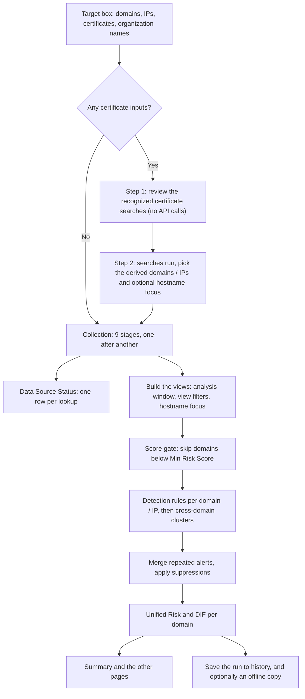
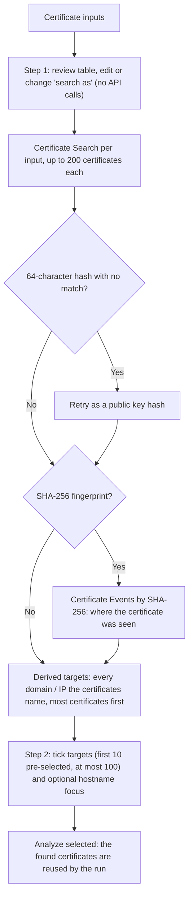
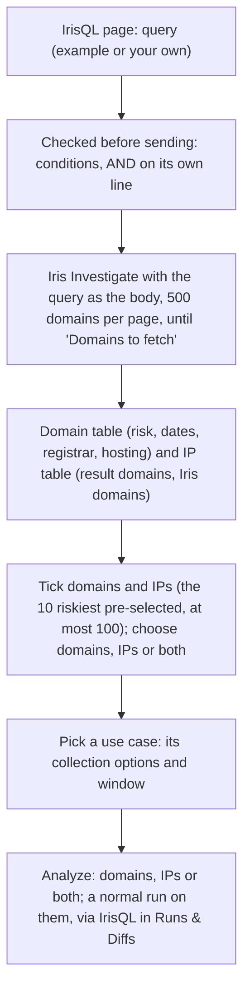
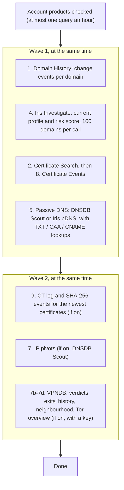
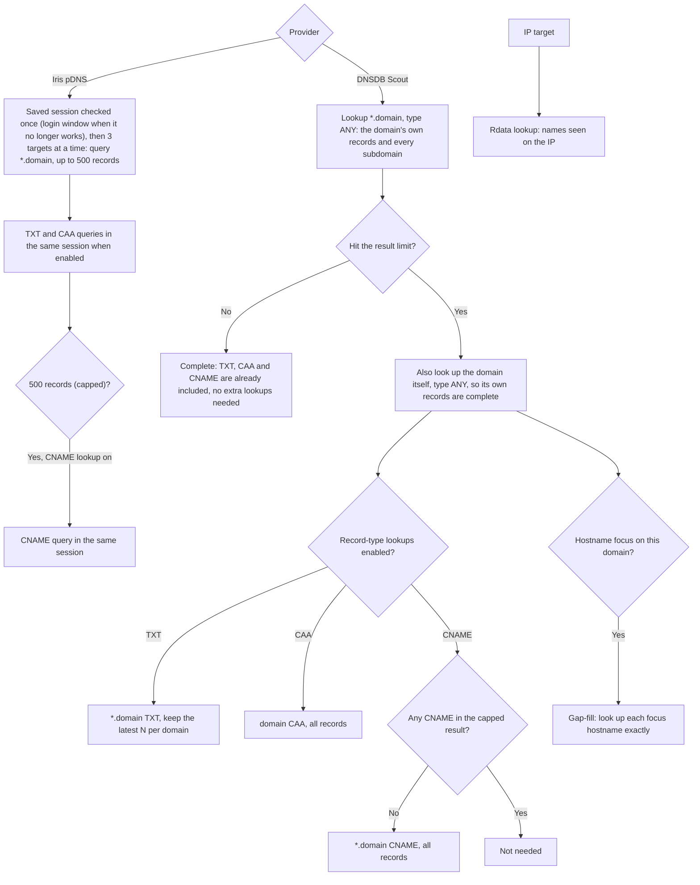
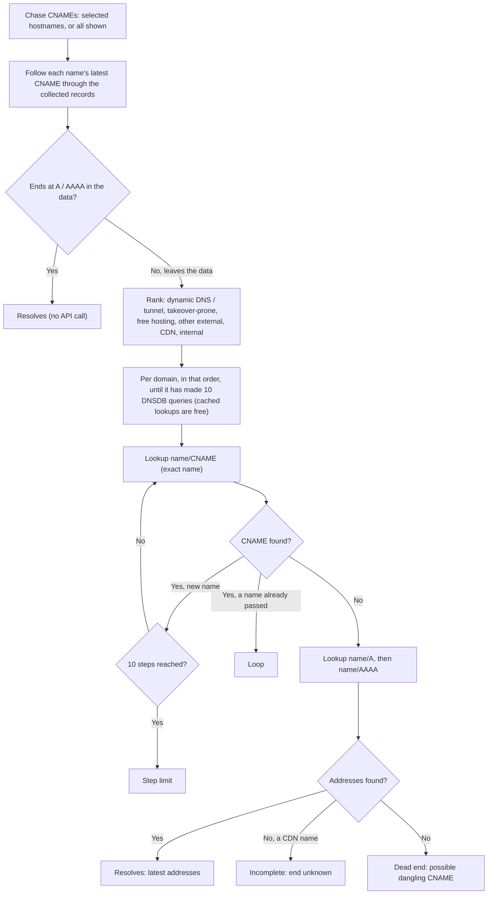
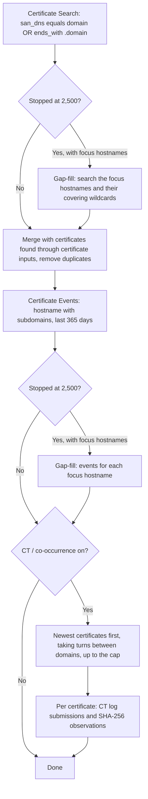
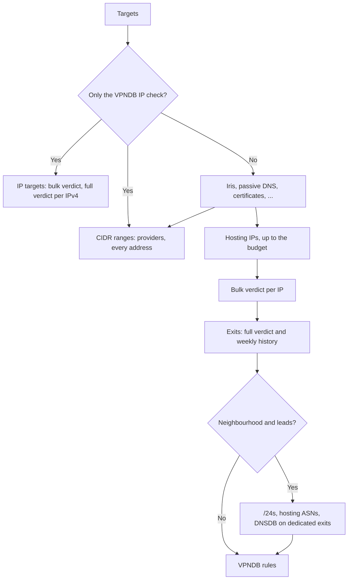

# Workflows

A first-time overview of what happens after you click **Analyze**: which data sources are queried, in what order,
under which conditions, and what each one is used for. The investigations the tool supports, and where to look for
each, are in [Use Cases](USE_CASES.md).

For setup see [Installation](INSTALLATION.md), for every option see [Usage](USAGE.md), and for reading
alerts, scores and detections see the [User Guide](USER_GUIDE.md).

## Contents

- [The whole run at a glance](#the-whole-run-at-a-glance)
- [Step 0: reading the target box](#step-0-reading-the-target-box)
- [Certificate inputs: the two review steps](#certificate-inputs-the-two-review-steps)
- [IrisQL: finding the targets first](#irisql-finding-the-targets-first)
- [Collection order](#collection-order)
- [Passive DNS logic](#passive-dns-logic)
- [CNAME chasing](#cname-chasing)
- [Certificate logic](#certificate-logic)
- [VPNDB logic](#vpndb-logic)
- [After collection](#after-collection)
- [What each source feeds](#what-each-source-feeds)

## The whole run at a glance

Collection talks to the APIs. Everything after it (filters, window, focus, thresholds, page choice) works on the
collected data and reruns instantly, without new lookups. An **offline dataset** skips collection altogether.

## Step 0: reading the target box

Each line or token of the target box is classified before anything is looked up:

| You type | Treated as | What happens |
| --- | --- | --- |
| `example.com`, `www.shop.example.com` | Domain | Reduced to its registered (apex) domain, e.g. `example.com`. Subdomains are still covered: the lookups include every subdomain. |
| `8.8.8.8`, `2001:db8::1` | IP address | Looked up as an IP (passive DNS by IP, certificates naming the IP, certificate events on the IP) and checked in VPNDB. |
| `104.21.59.0/24`, `2a00:1450::/32` | CIDR range | Looked up in VPNDB only, as a range (providers inside it, and every address of an IPv4 range with known exits); the other sources take single IPs. `/32` and `/128` are plain IPs. |
| A 64 / 40 / 32-character hex value, `cn:`, `san:`, `org:`, `issuer:`, `serial:`, ... | Certificate input | Goes through the [two review steps](#certificate-inputs-the-two-review-steps) first. |
| `DomainTools LLC`, `DomainTools` (words without a dot) | Organization name | A certificate input: certificates whose subject organization contains the text. |

The full list of certificate prefixes is in [Certificate inputs](USAGE.md#certificate-inputs). **Force refresh
(bypass cache)** deletes the lookup cache (*Cache lifetime*, default 1 day) before the run.

## Certificate inputs: the two review steps

Only used when the target box contains certificate inputs. Plain domains and IPs on the same list skip this and
join the run directly.

## IrisQL: finding the targets first

Used instead of the target box when the targets are not known yet (**IrisQL** in the menu, or *Data source → IrisQL*
in the sidebar).

## Collection order

Stages that do not need each other run at the same time. In the first wave, Domain History, Iris Investigate and
the certificates (search, then events) run in the background while passive DNS runs in front, where the Iris pDNS
login window can appear. In the second wave, the CT telemetry (it needs the certificates) runs while the IP pivots
and the VPNDB check run (they need passive DNS and Iris). Within a stage, lookups run in parallel (up to 8 at a time,
4 for the Certificate API, 3 for Iris pDNS). The Certificate API stages stay one after another, because that API
answers too many parallel calls with HTTP 503. Every lookup adds a row to **Data Source Status**; *Partial* means it
stopped at a limit or failed part-way.

Before the first wave, the app checks the DomainTools account's products (the Account Information answer, at most one
query an hour). A stage whose product the account does not have is skipped with a status row saying so, instead of
failing lookup by lookup.

| # | Stage | Source | Runs for | What is asked | Limits | Condition / notes |
| --- | --- | --- | --- | --- | --- | --- |
| 1 | Domain History | DomainTools API (SDK) | Each domain | Every recorded change: IPs, name servers, registrar, MX, SSL, ... | Max changes: 1,000 change events per domain by default, 100 to 20,000, or no limit (100 per query, newest first) | Always. Also provides historical SSL certificates. With a *Domain History period* (the analysis window or a number of days; Monitor changes: 90 days), paging stops at the first older change. A domain that reaches Max changes is listed as having more changes. |
| 2 | Certificate Search | Certificate API | Each domain and IP | CertsQL: certificates naming the domain or any subdomain (`san_dns equals` / `ends_with`), or naming the IP | 2,500 certificates per target | Always. Certificates found through certificate inputs are merged in. [Hostname gap-fill](#certificate-logic) if capped. |
| 4 | Iris Investigate | DomainTools API (SDK) | All domains, 100 per call | Current registration, IPs and ASNs, name servers, MX, SPF, SSL, web trackers, website response, redirects, popularity rank, and the DomainTools risk score with its components (proximity, threat profile, ...) | 100 domains per call | Always. The risk score feeds the score gate; no separate Risk Evidence query is made. |
| 5 | Passive DNS | DNSDB Scout or Iris pDNS | Each domain and IP | DNS records ever seen for the domain and its subdomains, or names seen on the IP | DNSDB: your limit (default 5,000) per name. Iris: 500 per query | Always. TXT / CAA / CNAME lookups and hostname gap-fill as described in [Passive DNS logic](#passive-dns-logic). With *Incremental passive DNS* (DNSDB), only records seen since the last offline copy of the same targets. |
| 7 | IP pivots | DNSDB Scout | Up to 3 hosting IPs per domain, 10 in total (Settings) | Other names that resolved to the domain's IPs, and when | 2,000 records per IP | Only when *Pivot on hosting IPs* is on and the provider is DNSDB Scout. IPs come from Iris (current) first, then the latest passive DNS; CDN and private IPs are skipped. |
| 7b | VPN / proxy / Tor | VPNDB | Public IPv4 hosting IPs: IP targets, current Iris IPs, then passive DNS (latest first); up to the use case's *Hosting IPs per run* (500 by default, 100 per domain at most); CIDR targets | Which VPN, residential proxy or Tor operator is behind each IP, with confidence, sharing and IOC value; per range its providers and every address | One bulk request; full verdict of up to *Full verdicts per run* exits (50 by default); per range one prefix query, up to 200 addresses and a bulk request for up to 1,024 addresses | Only with a VPNDB key and *Check hosting IPs for VPN, residential proxy and Tor* on (on in every use case). CDN, private and IPv6 addresses are skipped. |
| 7c | VPNDB context | VPNDB, DNSDB | The exits (weekly history, as many as the full verdicts), and with *Neighbourhood and leads*: the /24s around the other hosting IPs (30), current Iris ASNs (20), dedicated exits (DNSDB reverse IP, 10) | Was the IP an exit while the domain used it; hosted among exits; other domains on dedicated exits | 1 query each | Only with a VPNDB key and the VPNDB check on; the neighbourhood is off in the takeover, phishing and monitoring use cases; the DNSDB lookups need a DNSDB key. Feeds the exit rules, *Hosted Among Anonymizer Exits* and the VPNDB page. |
| 7d | Tor network | VPNDB | Once per run | The Tor overview (`/tor`): relays and each network's, country's and prefix's share of Tor exit traffic | One call, not counted against the quota | With the VPNDB check and in *Check IP addresses*. Feeds the Tor network page (Infrastructure) and each IP card. |
| 8 | Certificate Events | Certificate API | Each domain (with subdomains) and IP | Where certificates were observed on hostnames / IPs | 2,500 events per target, last 365 days | Always. Hostname gap-fill if capped. |
| 9 | CT / co-occurrence | Certificate API | The newest Certificate API certificates, taking turns between domains | CT log submissions (500 per certificate) and SHA-256 observations (1,000 per certificate) | Settings cap, default 10 certificates (two calls each) | Only when *Fetch CT log & certificate co-occurrence telemetry* is on. |

Failed Certificate API lookups are retried once, one at a time, after a 5-second pause (bursts of parallel calls
can return HTTP 503). All HTTP lookups also retry on rate limits and server errors, and so do the DomainTools SDK
calls (Iris Investigate, Domain History, Account): after 2 s and 4 s on HTTP 429 / 5xx or a connection error. The SDK
also spaces its calls to each product's per-minute limit. Successful lookups are cached on disk, so re-running the
same targets, or a new run that repeats a domain, costs no API query for them: for the *Cache lifetime* (default
1 day), or a source's own lifetime (Domain History 7 days, VPNDB 6 hours by default; Settings → Lookup cache).
Iris pDNS results are cached like the others.

## Passive DNS logic

- **Why the record-type lookups exist:** on busy domains the result limit fills with A / NS rows before any TXT, CAA or CNAME
  record appears. TXT records drive SPF, tunneling and SaaS fingerprint detections; CAA drives the CAA audit; CNAME
  records drive the CNAME chains and their detections. A capped result holds only some CNAMEs, so the CNAME
  lookup runs whenever the main lookup was capped; DNSDB returns it aggregated (one record per hostname and
  target), so 5,000 records cover thousands of hostnames instead of daily repeats of a few.
- **Why the limit matters:** a capped domain is marked *Partial* and the Hostname Inventory does not flag
  *Certificate, never resolved* for it, since the records may simply be missing. Raise **DNSDB Result Limit per
  Domain** when you need more.
- **Incremental passive DNS (DNSDB):** with *Incremental passive DNS* on (Monitor changes), and an offline copy of
  the same targets saved with the same provider and DNSDB limit, the main lookup asks DNSDB only for records last
  seen since a day before that copy (`time_last_after`). The copy's older records are added; a record seen again
  replaces its earlier version. Each target is still one DNSDB query, but the result limit holds new records, not
  old ones, and the lookup is faster. Targets missing from the copy, and runs without one, are looked up in full.
  Save an offline copy of each run so the next one builds on it.

## CNAME chasing

Chains are chased on demand, from the **CNAME Chains** page: the selected hostnames, or every one shown. Each chain is
followed through the collected records first (free). Where it leaves the collected data, it is chased in DNSDB, the
same way **CNAME chasing** works in DNSDB Scout, up to 10 DNSDB queries per domain per click:

Each step follows the most recently seen CNAME, and each lookup is one record type of one exact name, so a busy
name's other records cannot push the CNAME out of a capped result. Every lookup adds a *DNSDB CNAME Chase (type)* row
to Data Source Status and to Lookup Queries. A chase stopped by the query limit keeps its path and continues from
there on the next click. Chase lookups use the lookup cache; *Re-chase (skip cache)* in the page repeats them fresh.

From the page, a **reverse CNAME** lookup (`rdata/name/{target}/CNAME`, up to 5,000 records, one *DNSDB CNAME RDATA*
row each) lists every name, of any domain, that points to a chain's target or a typed name. Analyzed domains found this way join the cross-domain links;
other domains are shown as related domains.

## Certificate logic

Domain History and Iris Investigate add their own certificate data (historical and currently served certificates),
so the SSL views combine all three sources.

## VPNDB logic

With *Only the VPNDB IP check* (*Check IP addresses*) domain targets are skipped and no other source runs. Otherwise
the hosting IPs are the IP targets, each domain's current Iris IPs and its passive DNS addresses, most recently seen
first (public IPv4, no CDN addresses). The rules then weigh whether each IP was an exit while the domain used it,
dedicated exits, hosting that moved onto or rotates across exits, new domains on an exit, exits several analyzed
domains share, and hosting next to exits.

Every VPNDB lookup is a row in Data Source Status with the request it made (Lookup Queries → VPNDB rebuilds it as a
curl command), and its answer is kept as received (Raw Records → VPNDB Responses, Data Export → VPNDB responses). A
miss (`observed: false`) counts as *No data*, not an error; a quota or key problem is an error with VPNDB's own note.

## After collection

| Step | What happens | Changes without new lookups? |
| --- | --- | --- |
| Analysis window | Records outside the chosen period are left out of detections and charts | Yes |
| View filters | Domains, Domain History types, passive DNS record types | Yes |
| Hostname focus | Passive DNS, certificates and certificate events of a domain narrowed to chosen hostnames | Yes |
| Score gate | Domains with a DomainTools risk score below **Min Risk Score** skip the behavioral rules; domains without a score are still checked | Yes |
| Detection | Every rule runs per domain / IP, then cross-domain checks (clusters, shared trackers, shared CNAME targets, domain hopping). A domain among the 10,000 most popular in Iris has its Medium and Medium-High confidence alerts lowered one step, with the reason in the alert | Yes |
| Merge and suppress | Repeats become one alert per domain and rule; suppressed findings are hidden | Yes |
| Scoring | Unified Risk score and DIF fingerprint per domain | Yes |
| Save | Live runs go to run history (`dt_runs/`); **Save offline copy** (sidebar, before Analyze; or after it on the status line or under *Manage Data*) also stores the raw data (`dt_offline/`) | - |

## What each source feeds

| Source | Used for | Example detections and views |
| --- | --- | --- |
| Domain History | Timeline of changes, historical certificates | Parked-to-Weaponized, Parking Exit, Phishing/Spam Prep, domain story timeline |
| Certificate Search | Certificates naming the domain, its subdomains or IP | Mega-SAN, Certificate Churn, CAA breach, weak keys, validity, CT Log Evasion (missing SCTs), Pre-Certificate Staging, Cert-to-DNS gap (with passive DNS), Hostname Inventory, Subdomain Triage |
| Iris Investigate risk score | DomainTools risk score and components (from the Iris records) | Score gate, Unified Risk, KPI banner |
| Iris Investigate | Current registration, hosting, mail (MX, SPF), trackers, website, popularity rank | Newly Registered Domain, hosting watchlist, Shared Web Tracker, Cross-Domain Redirect, streaming panels, High-Risk Mail Provider and Highly Permissive SPF (+all) from the current MX / SPF, lower confidence on popular domains, Pivot Ranking (Iris pivot counts), Domain profile |
| Passive DNS | Every DNS record and when it was seen | Fast-flux, DNS tunneling / TXT payloads, SPF, sinkholes, nested subdomains, origin IP exposure, CNAME chains and their detections |
| TXT / CAA / CNAME lookups | Complete TXT, CAA and CNAME records on busy domains | SPF and TXT detections, CAA audit, CNAME Chains page |
| CNAME chases | Where CNAMEs that leave the collected data end | Dangling CNAME (subdomain takeover), long chains and loops, final addresses in the CNAME Chains page |
| IP pivots | Other names that used the domain's hosting IPs | Domain hopping, DNS & Hosting page |
| Certificate Events | Hostnames and IPs where certificates were observed | Potential Origin IP Exposure, hostname flow in the Certificates page, subdomains in the DNS & Hosting page, Hostname Inventory |
| VPNDB verdicts | VPN, residential proxy and Tor attribution of the hosting IPs and IP targets | Domain on Tor Relay / Exit Node, on Residential Proxy Exit, on VPN / Proxy Exit, on Dedicated Anonymizer Exit, Hosting Moved onto / Rotating Across Anonymizer Exits, Newly Registered Domain on Anonymizer Exit, Anonymizer Exit Shared by Analyzed Domains; VPNDB page, Summary, Domain profile, confirmed indicators (shared exits left out) |
| VPNDB history | The weeks each exit was one | Exit alerts only when the IP was an exit while the domain used it; exposure timeline |
| VPNDB ranges and networks | Known exits around the hosting IPs and on the Iris hosting ASNs; CIDR targets | Hosted Among Anonymizer Exits; Neighbourhood and CIDR ranges tabs |
| DNSDB on dedicated exits | Other names on an exit few customers share | Leads tab (*Analyze*) |
| VPNDB Tor overview | Where Tor exit traffic leaves: networks, countries, prefixes | Hosted Among Tor Exits; Tor network page, Tor share on each IP card |
| CT / co-occurrence | CT log submissions, other hosts sharing a certificate | CT log panel in the Certificates page, certificate co-occurrence in Raw Records (context, not detections) |
